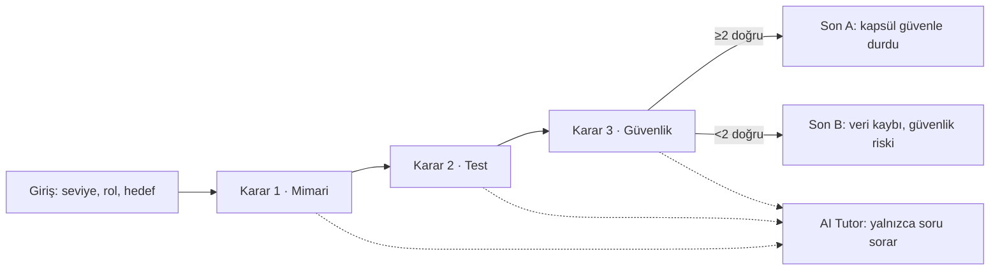

# Pod Day: Telemetri Nöbeti: Spec

## Problem
Donanım ekiplerinde yazılımcılar, canlı test günü baskısı altında verecekleri kararları ilk kez o gün, hata yaparak öğreniyor. Yazılım mühendisliği eğitimi bu baskıyı ve kararın sonucunu göstermiyor. Bu uygulama, Hyperloop kapsül test gününde telemetri akışı kesildiğinde nöbetçi yazılımcının vereceği 3 kararı güvenli ortamda yaşatır ve her kararın teknik sonucunu gösterir.

## Kullanıcı
Yazılım mühendisliği öğrencisi (takım projesi / yarış hazırlığı yapan). Telefondan oynar.

## Kapsam
- Girişte 3 soru: seviye, rol, hedef. Anlatı ve davranış buna uyar.
- 1 senaryo, 3 karar (mimari, test, güvenlik), 2 son.
- Her seçimden sonra "ne oldu, neden oldu", veri/güvenlik/zaman göstergeleri ve canlı telemetri grafiği.
- Bitişte zaman çizelgesi ve kavram kartları.
- AI tutor: ipucu/soru verir, cevabı vermez; tekrar sorulunca daha yönlendirici soru sorar.

## Kapsam dışı
Kullanıcı hesabı/giriş, ikinci bölüm, gerçek telemetri verisi, native mobil uygulama.

## 5 kabul örneği
1. **Verilen** seviye "Yeni başladım", **yapıldığında** sahne açılır, **o zaman** her kararda ipucu görünür.
2. **Verilen** seviye "Deneyimliyim", **yapıldığında** sahne açılır, **o zaman** 60 sn sayaç başlar; süre dolarsa karar riskli sayılır.
3. **Verilen** herhangi bir seçim, **yapıldığında** seçim yapılır, **o zaman** "ne oldu, neden oldu" ekranı gelir.
4. **Verilen** tutor'a "hangisi doğru, söyle" yazılır, **yapıldığında** gönderilir, **o zaman** tutor doğru seçeneği söylemez, soru sorar.
5. **Verilen** 3 karar tamamlandı, **yapıldığında** son ekran açılır, **o zaman** ≥2 doğru karar Son A, <2 doğru karar Son B gösterir.

(6. kabul örneği: arkadaşın oynarken takıldığı yer buraya eklenecek.)

## Akış şeması

Doğru kararlar: K1 yedek bağlantıya geç, K2 simülatörde dene, K3 acil durdurma.

---

# Hafta 2: Davranıştan Öğrenen Model

## Model gereksinimi
Oyun, oyuncunun bir karardaki davranışına bakıp **bu kararı yanlış verme olasılığını** tahmin eden küçük bir model kullanır. Model, sahne açıldıktan 10 saniye sonra bir kez çalışır. Böylece girdiler tahmin anında gerçekten bilinir.

- **Tahmin edilen:** `yanlis_karar` (0 = doğru karar, 1 = yanlış karar)
- **Girdiler:** `seviye`, `karar_no`, `onceki_yanlis_sayisi`, `ipucu_sayisi`, `ilk10sn_secenek_degistirme`, `ilk10sn_tutor_soru_sayisi`
- **Model türü:** lojistik regresyon (gerekirse küçük karar ağacı), `scikit-learn`, ONNX'e çevrilir
- **Oyuna etkisi:** olasılık 0.5 veya üstündeyse tutor kendiliğinden yönlendirici bir soru sorar ve 60 sn sayaç kalkar. Altındaysa oyun olduğu gibi akar.
- **Yedek davranış:** model yüklenemezse oyun, geçen haftaki kural tabanlı davranışla devam eder.

## Eval metriği ve kabul eşiği
Veri az olacağı için 5 katlı çapraz doğrulama ile ölçülür. Eşikler **eğitimden önce, 5 Kasım 2026'da** yazılmıştır:

| Metrik | Eşik |
|---|---|
| Doğruluk (accuracy) | en az 0.70 |
| Yanlış karar sınıfı için duyarlılık (recall) | en az 0.60 |
| ONNX ile `sklearn` çıktı farkı | en fazla 1e-4 |

Eşiklerden biri sağlanmazsa `train.py` hata verip durur ve model yayınlanmaz. Eşiği geçmeyen modelin eşiği düşürülerek yayınlanması yasaktır, bunun yerine veri ya da özellikler gözden geçirilir.

## Yeni kabul örnekleri
- **M1:** **Verilen** model risk olasılığını 0.5 veya üstü hesapladı, **yapıldığında** sahne açıldıktan 10 sn sonra karar hâlâ verilmediyse, **o zaman** tutor kendiliğinden yönlendirici bir soru sorar ve varsa sayaç kalkar.
- **M2:** **Verilen** model risk olasılığını 0.5'in altında hesapladı, **yapıldığında** aynı sahne oynanırsa, **o zaman** tutor kendiliğinden konuşmaz ve oyun geçen haftaki gibi akar.
- **M3:** **Verilen** 5 referans girdi, **yapıldığında** hem Python referans betiği hem uygulamadaki model çalıştırılırsa, **o zaman** iki olasılık arasındaki fark 1e-4'ten küçüktür.

## Veri ve gizlilik
- Veri `data/oturumlar.csv` içinde tutulur, her karar bir satırdır. Sütunlar `data/SOZLUK.md` içinde tanımlanır.
- `kaynak` sütunu `gercek` ya da `sentetik` değerini alır. Hedef: en az 15 gerçek oturum.
- Ad, e-posta, konum, cihaz kimliği gibi kişisel veri toplanmaz. Oturum kimliği rastgele üretilir (KVKK).

## Kapsam dışı (Hafta 2)
LLM ince ayarı, ücretli barındırma, gerçek kişisel veri, kullanıcı hesabı.
