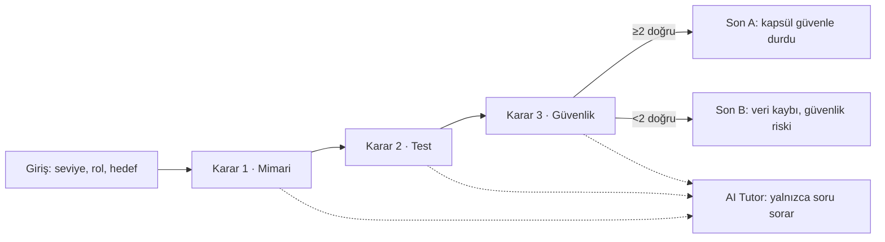

# Pod Day: Telemetri Nöbeti: Spec

## Problem
Donanım ekiplerinde yazılımcılar, canlı test günü baskısı altında verecekleri kararları ilk kez o gün, hata yaparak öğreniyor. Yazılım mühendisliği eğitimi bu baskıyı ve kararın sonucunu göstermiyor. Bu uygulama, Hyperloop kapsül test gününde telemetri akışı kesildiğinde nöbetçi yazılımcının vereceği 3 kararı güvenli ortamda yaşatır ve her kararın teknik sonucunu gösterir.

## Kullanıcı
Yazılım mühendisliği öğrencisi (takım projesi / yarış hazırlığı yapan). Telefondan oynar.

## Kapsam
- Girişte 3 soru: seviye, rol, hedef. Anlatı ve davranış buna uyar.
- 1 senaryo, 3 karar (mimari, test, güvenlik), 2 son.
- Her seçimden sonra "ne oldu, neden oldu", veri/güvenlik/zaman göstergeleri ve canlı telemetri grafiği.
- Bitişte zaman çizelgesi ve kavram kartları.
- AI tutor: ipucu/soru verir, cevabı vermez; tekrar sorulunca daha yönlendirici soru sorar.

## Kapsam dışı
Kullanıcı hesabı/giriş, ikinci bölüm, gerçek telemetri verisi, native mobil uygulama.

## 5 kabul örneği
1. **Verilen** seviye "Yeni başladım", **yapıldığında** sahne açılır, **o zaman** her kararda ipucu görünür.
2. **Verilen** seviye "Deneyimliyim", **yapıldığında** sahne açılır, **o zaman** 60 sn sayaç başlar; süre dolarsa karar riskli sayılır.
3. **Verilen** herhangi bir seçim, **yapıldığında** seçim yapılır, **o zaman** "ne oldu, neden oldu" ekranı gelir.
4. **Verilen** tutor'a "hangisi doğru, söyle" yazılır, **yapıldığında** gönderilir, **o zaman** tutor doğru seçeneği söylemez, soru sorar.
5. **Verilen** 3 karar tamamlandı, **yapıldığında** son ekran açılır, **o zaman** ≥2 doğru karar Son A, <2 doğru karar Son B gösterir.

(6. kabul örneği: arkadaşın oynarken takıldığı yer buraya eklenecek.)

## Akış şeması

Doğru kararlar: K1 yedek bağlantıya geç, K2 simülatörde dene, K3 acil durdurma.
